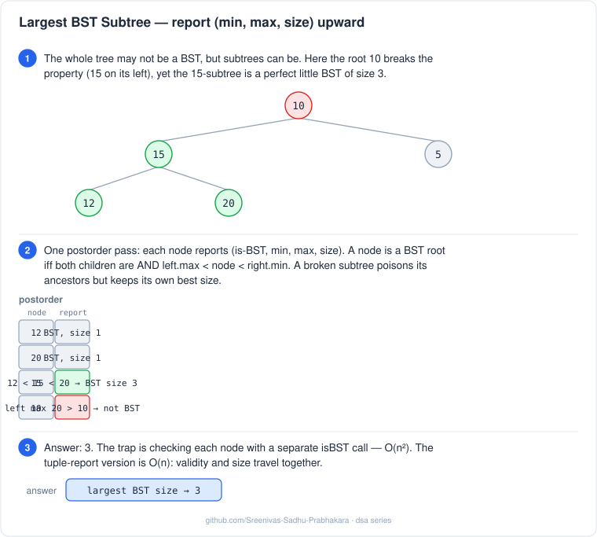

# Largest BST in a Binary Tree

> Striver SDE Sheet 144 · Day 21 BST II — postorder summaries (min, max, size, isBST) combine in O(1) per node; ±∞ sentinels make nil children vacuous. Go, stdlib only, tested.

## Problem

In an arbitrary binary tree, find the node count of the largest subtree that is a valid (strict) BST. Validating every subtree from scratch is O(n²); the sheet wants one pass.

## Approach

Ask each subtree to summarize itself in exactly the four facts a parent needs: its min, its max, its size, and whether it's a BST. A node's subtree is a BST iff both children are and `l.max < node < r.min` — an O(1) combination, so the whole computation is a single postorder walk, tracking the best size seen. The nil summary uses ±∞ sentinels (min = +∞, max = −∞, BST = true), which make empty children satisfy every comparison vacuously — no special cases for leaves or single children. This "design the return struct so merging is O(1)" move is the general recipe for tree-DP problems.

**Complexity:** O(n) time, O(h) recursion.

## Visual walkthrough

Read the picture top to bottom — each numbered frame is one moment of the algorithm
running on this repo's test example.

## Run

    go test ./...   # verify
    go run .        # demo

---

One of 191 repos solving Striver's SDE Sheet in Go — stdlib only, one problem per repo, every solution tested. Browse the set: [`dsa-*` repos](https://github.com/Sreenivas-Sadhu-Prabhakara?tab=repositories&q=dsa-&type=source).
